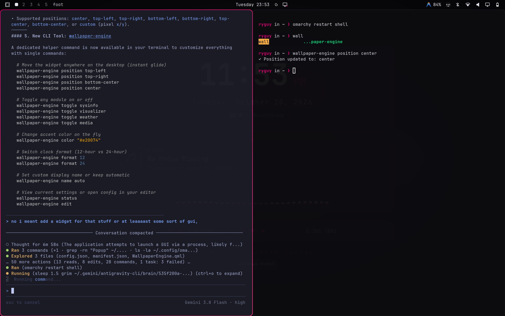

# 󰏘 Wallpaper Engine Widget for Omarchy

An interactive, modular desktop widget and control center for **Omarchy** and **Hyprland**, featuring Obsidian Dark and T-Mobile Magenta (`#e20074`) aesthetic, live hardware monitoring (CPU temps, fan speeds, RAM), 60 FPS PipeWire audio spectrum visualizer, customizable application dock, and real-time GUI customizer.



---

## 🚀 Quick Install

### Via Omarchy Shell Plugin Manager (Recommended)
```bash
omarchy plugin add https://github.com/ryguy0601/omarchy-wallpaper-engine.git --enable
```

### Manual Git Clone
```bash
git clone https://github.com/ryguy0601/omarchy-wallpaper-engine.git ~/.config/omarchy/plugins/ryguy.wallpaper-engine
cd ~/.config/omarchy/plugins/ryguy.wallpaper-engine
./install.sh
omarchy restart shell
```

---

## ✨ Features

- 󱑂 **Digital Monospace Clock**: 12-hour or 24-hour mode, AM/PM tag, running seconds (`:SS`), and customizable font size slider (48px–110px).
- 󰈸 **Real-Time Hardware Telemetry**: Live CPU load, core package temperatures with heat warnings (green, amber, red), chassis fan speeds (RPM), memory usage gauge, and optional GPU monitoring. Supports both Celsius (°C) and Fahrenheit (°F).
- 󰈹 **Customizable Shortcuts Dock**: Interactive desktop launcher. Add custom apps, change icons (Nerd Font glyphs), edit commands, and reorder shortcuts directly in the GUI or via CLI.
- 󰎆 **MPRIS Now-Playing Media**: Track title, artist, album art, and interactive playback buttons (previous, play/pause, next).
- 󰓃 **60 FPS Audio Visualizer**: Real-time PipeWire audio spectrum analyzer powered by CAVA with floating peak physics and idle ambient sine waves.
- 󰖐 **Live Weather Pill**: Local temperature and condition icon integrated with Omarchy weather services.
- 󰸗 **Date & Calendar**: Full weekday, month, day, and year.
- 󰝗 **Daily Inspiration / Note**: Custom quote banner and author tag.
- 󰮈 **Personal Branding Footer**: Dynamically resolves `$USER` or displays your custom handle.
-  **Customizable Widget Button**: Keep the `[  Customize Widget ]` pill button or hide it completely.
- 🎨 **7-Tab GUI Customizer**: Full control center for Layout, Modules, Apps & Dock, Hardware, Colors, Visualizer, and Wallpapers.
- 🤖 **AI Agent Friendly**: Comes with [`WALLPAPER_ENGINE.md`](WALLPAPER_ENGINE.md) handbook for single-command agent configuration.

---

## 🛠️ Configuration & CLI Tool

Wallpaper Engine includes the `wallpaper-engine` CLI utility:

```bash
# Launch graphical settings control center
wallpaper-engine gui

# View real-time hardware telemetry (CPU temp, fan speeds, RAM)
wallpaper-engine hw

# Toggle hardware sensors on the desktop
wallpaper-engine hw toggle cputemp
wallpaper-engine hw toggle fanspeed
wallpaper-engine hw toggle unit

# Manage application shortcuts dock
wallpaper-engine shortcut list
wallpaper-engine shortcut add Discord "󰒱" "discord"
wallpaper-engine shortcut remove 7
wallpaper-engine shortcut reset

# Show or hide the Customize Widget button
wallpaper-engine toggle customize-button

# Position widget (center, top-left, top-right, bottom-left, bottom-right, custom)
wallpaper-engine position top-left
wallpaper-engine coords 120 100

# Change accent color
wallpaper-engine color "#00e5ff"

# Apply changes and restart shell
wallpaper-engine restart
```

---

## ⚙️ Configuration File (`~/.config/wallpaper-engine/config.json`)

All configuration is hot-reloaded automatically upon saving:

```json
{
  "layout": {
    "position": "center",
    "customX": 100,
    "customY": 100,
    "width": 720,
    "spacing": 22
  },
  "modules": {
    "clock": true,
    "date": true,
    "weather": true,
    "media": true,
    "visualizer": true,
    "sysinfo": true,
    "shortcuts": true,
    "quote": false,
    "footer": true,
    "customizeButton": true
  },
  "hardware": {
    "showCpuLoad": true,
    "showCpuTemp": true,
    "showFanSpeed": true,
    "showRam": true,
    "showGpuTemp": false,
    "tempUnit": "C"
  },
  "shortcuts": [
    { "icon": "󰈹", "label": "Browser", "cmd": "omarchy-cmd-default-browser || xdg-open https://google.com" },
    { "icon": "󰆍", "label": "Terminal", "cmd": "omarchy-default-terminal || foot" },
    { "icon": "󰉋", "label": "Files", "cmd": "thunar || omarchy-file-select" },
    { "icon": "󰨞", "label": "Editor", "cmd": "omarchy-default-editor || code || foot -e nvim" },
    { "icon": "󰎆", "label": "Music", "cmd": "playerctl play-pause 2>/dev/null || true" },
    { "icon": "", "label": "Settings", "cmd": "wallpaper-engine gui" }
  ]
}
```

---

## 📋 Architecture & File Layout

| File | Purpose |
|------|---------|
| `manifest.json` | Omarchy shell plugin manifest (schemaVersion 1) |
| `WallpaperEngine.qml` | Desktop layer-shell widget with CAVA visualizer & hardware gauges |
| `SettingsWindow.qml` | 7-tab GUI overlay customizer |
| `cava.conf` | PipeWire audio spectrum configuration |
| `bin/wallpaper-engine` | Python CLI and telemetry collector |
| `install.sh` | One-click installer & desktop shortcut creator |
| `uninstall.sh` | Clean uninstaller script |
| `WALLPAPER_ENGINE.md` | Comprehensive AI Agent & developer reference handbook |

---

## 📄 License

MIT License — Copyright (c) 2026 Ryan Cuccurullo (ryguy).
